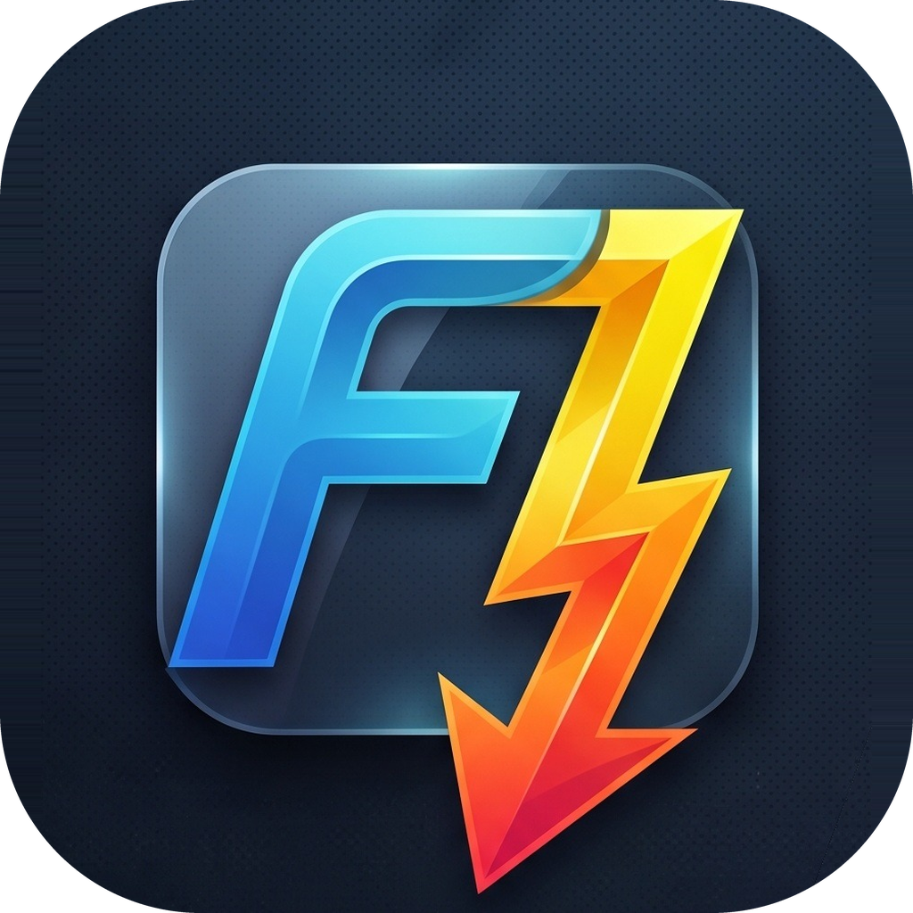

# FDownloader - Next Generation Download Manager

  

  <strong>High-performance, modern, multi-threaded, and intelligent desktop download manager.</strong>

  
  
  
  
  

  
  &nbsp;
  

---

## 🚀 Key Features (v2.0.0)

* ⚡ **High-Speed Multi-Part Downloading:** Segments HTTP/HTTPS connections dynamically to fully utilize available bandwidth; effortlessly resumes interrupted transfers (Lossless Resume).
* 🌊 **BitTorrent & Magnet Support:** Full support for Magnet links and `.torrent` files with preview file selection, sequential downloading (streaming mode), and peer tracking.
* 🎥 **Advanced Media & Video Downloader:** yt-dlp integration supporting 4K/1080p video, live streams/HLS, automatic MP3 extraction, and embedded subtitles.
* 🧩 **Browser Extension & Floating Grabber:** Sniff downloads and streaming media directly from Chrome, Edge, and Firefox.
* 🔒 **File Integrity & Hash Verification:** Automatic calculation and one-click verification of MD5, SHA-1, and SHA-256 hashes against expected values.
* 📦 **Auto Archive Extractor & Password Support:** Automatically extracts ZIP, RAR, 7Z, and TAR archives upon download with password dialog and security filters (Zip-Slip/Zip-Bomb protection).
* 🛡️ **Network Adapter Binding (VPN Kill-Switch):** Locks downloads strictly to a specified physical or VPN network adapter; immediately pauses transfers if the connection drops.
* 🕸️ **Site & Gallery Grabber:** Discovers and queues all media, image, audio, or document links from any webpage with a single click.
* 🌙 **Sleep Mode Prevention:** Keeps the computer awake while downloads are active and restores default power behavior when finished.
* ⏱️ **Scheduler & Smart Speed Limiter:** Schedule downloads at specific times and dynamically constrain download/upload bandwidth.
* 🔄 **Transparent Updates with Changelog:** Check for new versions, review release notes before updating, and update safely with user confirmation.
* 🖥️ **System Tray & Clipboard Watcher:** Seamlessly minimizes to the notification area, monitors clipboard links, and auto-starts with Windows.
* 🎨 **Modern Themes & Multilingual:** Smooth Avalonia UI with dark/light themes, fully localized in Turkish and English.

---

## 📥 Quick Installation

1. Download the [Latest Release Installer (FDownloader-win-Setup.exe)](https://github.com/erbayfaruk61/FDownloader/releases/latest/download/FDownloader-win-Setup.exe).
2. Run the installer.
3. Desktop and Start Menu shortcuts are created automatically.

---

## 🧩 Browser Extension Setup

To capture downloads and video streams automatically from Chrome, Edge, Brave, Opera, or Firefox:

1. Download `FDownloader-Browser-Extension.zip` from [Releases](https://github.com/erbayfaruk61/FDownloader/releases/latest) and extract it to a folder *(or click "Open Extension Folder" in FDownloader **Settings > Browser**)*.
2. In your Chromium-based browser, navigate to:
   - **Chrome / Brave / Opera:** `chrome://extensions`
   - **Microsoft Edge:** `edge://extensions`
3. Toggle on **Developer Mode** in the top right.
4. Click **Load unpacked** in the top left and select the extracted extension folder.

---

## ⚖️ Legal Disclaimer

FDownloader is a general-purpose utility designed for legitimate personal content management and downloading. Users bear sole responsibility for ensuring compliance with copyright laws, intellectual property rights, and terms of service of third-party platforms. FDownloader does not circumvent DRM, bypass paywalls, or alter copy-protection systems.

---

## 📜 Credits & Acknowledgments

FDownloader is built on top of remarkable open-source projects:

* [Avalonia UI](https://avaloniaui.net/) - Cross-platform XAML GUI framework.
* [MonoTorrent](https://github.com/alanmcgovern/monotorrent) - BitTorrent client engine.
* [yt-dlp](https://github.com/yt-dlp/yt-dlp) - Media extraction engine.
* [SharpCompress](https://github.com/adamhathcock/sharpcompress) & [7-Zip](https://www.7-zip.org/) - Archive processing.
* [Velopack](https://velopack.io) - Modern desktop installation and update framework.
* Detailed notices: [THIRD_PARTY_NOTICES.md](THIRD_PARTY_NOTICES.md) | Privacy policy: [docs/GIZLILIK.md](docs/GIZLILIK.md)

---

## 📄 License

This project is licensed under the [MIT License](LICENSE).

