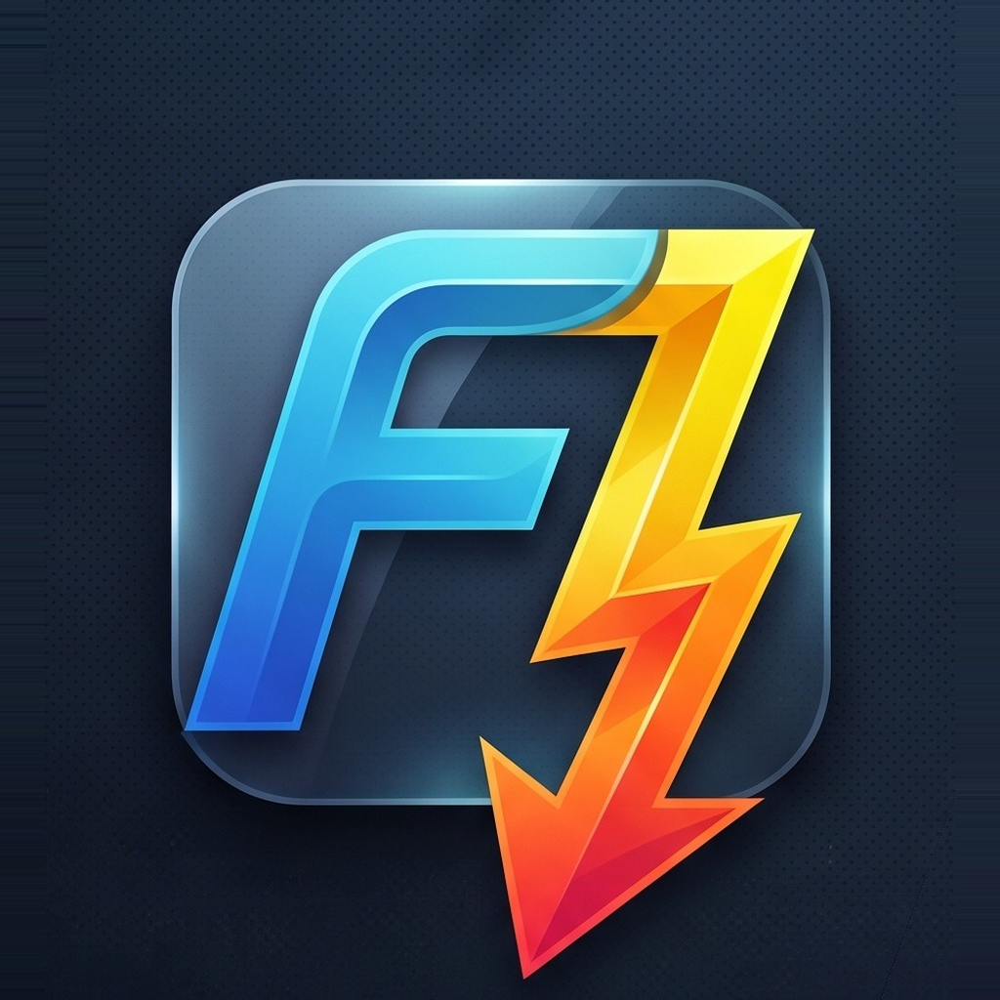

# FDownloader - Yeni Nesil İndirme Yöneticisi

<p align="center">
  
</p>

<p align="center">
  <strong>Yüksek performanslı, modern, çok kanallı ve akıllı masaüstü indirme yöneticisi.</strong>
</p>

<p align="center">
  <a href="https://github.com/erbayfaruk61/FDownloader/releases/latest">
    
  </a>
  
  
  
  
</p>

<p align="center">
  <a href="https://github.com/erbayfaruk61/FDownloader/releases/latest/download/FDownloader-win-Setup.exe">
    
  </a>
  &nbsp;
  <a href="https://github.com/erbayfaruk61/FDownloader/releases/latest/download/FDownloader-Browser-Extension.zip">
    
  </a>
</p>

---

## 🚀 Öne Çıkan Özellikler (v1.5.0)

* ⚡ **Çok Kanallı & Parçalı Hızlı İndirme:** HTTP/HTTPS bağlantılarını dinamik parçalara bölerek bant genişliğinizi tam kapasite kullanır; kopan veya duraklatılan indirmeleri sıfır kayıpla sürdürür.
* 🧩 **IDM Tarzı Video Köşe Yakalayıcısı (Floating Grabber):** Web sayfalarındaki videolarda fareyi hareket ettirdiğinizde sağ üstte otomatik beliren şık indirme butonu (YouTube, Vimeo ve popüler video platformları tam uyumlu).
* 🖥️ **Sistem Tepsisi (Tray) & Windows Başlangıcı:** Uygulama kapatıldığında veya simge durumuna alındığında bildirim alanına (Tray) küçülür; Windows açılışında otomatik başlatılabilir.
* 🔒 **Otomatik Arşiv Çözücü & Şifreli Arşiv Desteği:** İndirilen ZIP, RAR, 7Z, TAR dosyalarını indirme biter bitmez otomatik klasöre çıkartır. Şifreli arşivler için parola sorma diyalogu ve gömülü 7-Zip motoru içerir.
* 🛡️ **Ağ Adaptörü Kilidi (VPN Kill-Switch):** İndirmeleri yalnızca seçtiğiniz fiziksel ağ kartına veya VPN adaptörüne kilitler; VPN kesildiğinde indirmeleri anında güvenle durdurur.
* 🕸️ **Site & Galeri Yakalayıcı:** Bir web sayfasındaki tüm video, ses, görsel veya doküman linklerini tek tıklamayla tarayıp topluca indirme kuyruğuna ekler.
* 🌊 **BitTorrent Entegrasyonu:** Magnet linkleri ve `.torrent` dosyaları için ön izlemeli dosya seçimi, sıralı indirme (Streaming modu) ve eş takibi.
* 🔔 **Akıllı Toast Bildirimleri:** Ekranın sağ alt köşesinde içeriğe göre esneyen, doğrudan "Klasörü Aç" ve "Dosyayı Aç" seçenekleri sunan modern bildirimler.
* 🔄 **Kesintisiz Otomatik Güncelleme:** Velopack altyapısıyla yeni sürümleri arka planda kontrol eder ve tek tıkla uygulamayı günceller.
* 🎨 **Kişiselleştirilebilir Zengin Temalar:** Koyu Grafit, Gece Siyahı, Okyanus Mavisi gibi modern renk temaları ve temiz Avalonia UI tasarımı.

---

## 📥 Kurulum & Kullanım

1. [En Son Sürümü İndirin (FDownloader-win-Setup.exe)](https://github.com/erbayfaruk61/FDownloader/releases/latest/download/FDownloader-win-Setup.exe).
2. İndirilen kurulum dosyasını çalıştırın.
3. Masaüstü ve Başlat Menüsü kısayolları otomatik oluşturulur.

---

## 🧩 Tarayıcı Eklentisi Kurulumu

Tarayıcınızdaki indirmelerin ve videoların doğrudan FDownloader tarafından yakalanması için:

1. [Releases](https://github.com/erbayfaruk61/FDownloader/releases/latest) sayfasından `FDownloader-Browser-Extension.zip` dosyasını indirin ve bir klasöre çıkartın *(veya uygulama içindeki **Ayarlar > Tarayıcı** sekmesinden "Eklenti Klasörünü Aç" butonuna basın)*.
2. Tarayıcınızda eklentiler sayfasını açın:
   - **Chrome / Brave / Opera:** `chrome://extensions`
   - **Microsoft Edge:** `edge://extensions`
3. Sağ üst köşedeki **Geliştirici Modu (Developer Mode)** anahtarını etkinleştirin.
4. Sol üstteki **Paketlenmemiş Öğe Yükle (Load unpacked)** butonuna basarak çıkarttığınız klasörü seçin.

---

## 🛠️ Kaynak Koddan Derleme

```powershell
# Depoyu klonlayın
git clone https://github.com/erbayfaruk61/FDownloader.git
cd FDownloader

# Derleyin ve çalıştırın
dotnet run --project src/FDownloader.App/FDownloader.App.csproj
```

---

## 📜 Krediler & Teşekkürler

FDownloader aşağıdaki açık kaynak teknolojiler ve projeler üzerine inşa edilmiştir:

* [Avalonia UI](https://avaloniaui.net/) - Çapraz platform masaüstü arayüz çatısı.
* [MonoTorrent](https://github.com/alanmcgovern/monotorrent) - BitTorrent protokol kütüphanesi.
* [yt-dlp](https://github.com/yt-dlp/yt-dlp) - Video ve ses işleme motoru.
* [SharpCompress](https://github.com/adamhathcock/sharpcompress) & [7-Zip](https://www.7-zip.org/) - Arşiv ayrıştırma motorları.
* [Velopack](https://velopack.io) - Modern kurulum ve güncelleme dağıtım çerçevesi.

---

## 📄 Lisans

Bu proje [MIT Lisansı](LICENSE) kapsamında geliştirilmektedir.
