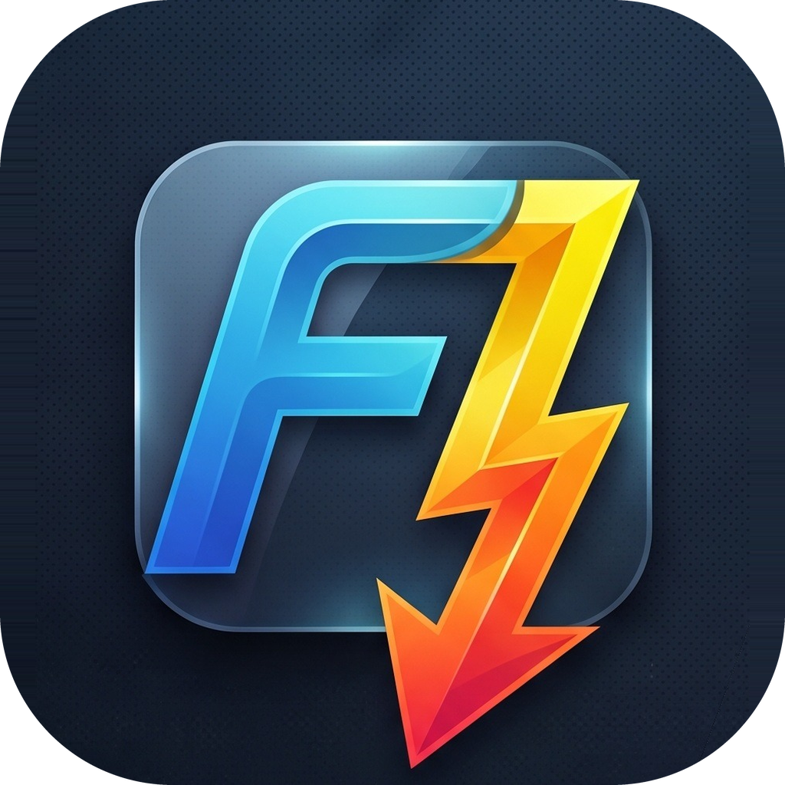

# FDownloader - Yeni Nesil İndirme Yöneticisi

  

  <strong>Yüksek performanslı, modern, çok kanallı ve akıllı masaüstü indirme yöneticisi.</strong>

  
  
  
  
  

  
  &nbsp;
  

---

## 🚀 Öne Çıkan Özellikler (v2.0.2)

* ⚡ **Çok Kanallı & Parçalı Hızlı İndirme:** Dinamik parçalı motor, tam bant genişliği kullanımı ve kayıpsız indirme devam ettirme (Lossless Resume).
* 🌊 **BitTorrent & Magnet Desteği:** Magnet linkleri ve `.torrent` dosyaları, sıralı indirme (Streaming modu), ön izlemeli dosya seçimi ve eş takibi.
* 🎥 **Gelişmiş Medya & Video İndirici:** yt-dlp altyapısıyla 4K/1080p video, canlı yayın/HLS akışları, otomatik MP3 dönüştürme ve altyazı desteği.
* 🧩 **Tarayıcı Eklentisi & Yüzen Yakalayıcı:** Chrome, Edge ve Firefox üzerinden indirme ve video yakalama (Floating Grabber).
* 🔒 **Dosya Bütünlüğü & Hash Doğrulama:** İndirilen dosyalar için anlık MD5, SHA-1 ve SHA-256 hesaplama ve eşleştirme kontrolü.
* 📦 **Otomatik Arşiv Açıcı & Şifre Desteği:** ZIP, RAR, 7Z ve TAR arşivlerini otomatik çıkartma, parola korumalı arşiv çözümü ve güvenlik filtreleri.
* 🛡️ **Ağ Adaptörü Kilidi & VPN Koruma:** İndirmeleri belirli bir ağ kartına veya VPN'e bağlama; bağlantı koptuğunda indirmeleri güvenle durdurma.
* 🕸️ **Site & Galeri Yakalayıcı:** Web sayfalarındaki tüm görsel, video, ses ve belgeleri tek tıkla tarayıp toplu indirme.
* 🌙 **Uyku Modu Engelleme:** Aktif indirmeler devam ederken bilgisayarın uykuya veya beklemeye geçmesini engelleme.
* ⏱️ **Zamanlayıcı & Akıllı Hız Sınırlayıcı:** Belirli saatlerde otomatik indirme planlama ve dinamik bant genişliği kısıtlama.
* 🔄 **Onaylı Güncelleme & Sürüm Notları:** Yeni sürümleri denetleme, indirmeden önce değişiklik günlüğünü (Changelog) gösterme ve onaylı güncelleme.
* 🖥️ **Sistem Tepsisi (Tray) & Pano İzleyici:** Panoya kopyalanan linkleri anında algılama, bildirim alanı entegrasyonu ve Windows ile başlama.
* 🎨 **Modern Temalar & Çoklu Dil:** Koyu/açık renk temaları, akıcı Avalonia UI arayüzü, Türkçe ve İngilizce dil seçeneği.

---

## 📥 Kurulum & Kullanım

1. [En Son Sürümü İndirin (FDownloader-win-Setup.exe)](https://github.com/erbayfaruk61/FDownloader/releases/latest/download/FDownloader-win-Setup.exe).
2. İndirilen kurulum dosyasını çalıştırın.
3. Masaüstü ve Başlat Menüsü kısayolları otomatik oluşturulur.

---

## 🧩 Tarayıcı Eklentisi Kurulumu

Tarayıcınızdaki indirmelerin ve videoların doğrudan FDownloader tarafından yakalanması için:

1. [Releases](https://github.com/erbayfaruk61/FDownloader/releases/latest) sayfasından `FDownloader-Browser-Extension.zip` dosyasını indirin ve bir klasöre çıkartın *(veya uygulama içindeki **Ayarlar > Tarayıcı** sekmesinden "Eklenti Klasörünü Aç" butonuna basın)*.
2. Tarayıcınızda eklentiler sayfasını açın:
   - **Chrome / Brave / Opera:** `chrome://extensions`
   - **Microsoft Edge:** `edge://extensions`
3. Sağ üst köşedeki **Geliştirici Modu (Developer Mode)** anahtarını etkinleştirin.
4. Sol üstteki **Paketlenmemiş Öğe Yükle (Load unpacked)** butonuna basarak çıkarttığınız klasörü seçin.

---

## ⚖️ Yasal Uyarı ve Sorumluluk Reddi

FDownloader, kullanıcılara genel amaçlı dosya ve içerik indirme kolaylığı sağlayan açık kaynaklı bir araçtır. Telif haklarına, fikri mülkiyet yasalarına ve ziyaret edilen web sitelerinin hizmet şartlarına uymak tamamen kullanıcının kendi sorumluluğundadır. FDownloader, DRM veya şifreleme ile korunan içeriklerin aşılmasına yönelik herhangi bir mekanizma içermez ve desteklemez.

---

## 📜 Krediler & Teşekkürler

FDownloader aşağıdaki açık kaynak teknolojiler ve projeler üzerine inşa edilmiştir:

* [Avalonia UI](https://avaloniaui.net/) - Çapraz platform masaüstü arayüz çatısı.
* [MonoTorrent](https://github.com/alanmcgovern/monotorrent) - BitTorrent protokol kütüphanesi.
* [yt-dlp](https://github.com/yt-dlp/yt-dlp) - Video ve ses işleme motoru.
* [SharpCompress](https://github.com/adamhathcock/sharpcompress) & [7-Zip](https://www.7-zip.org/) - Arşiv ayrıştırma motorları.
* [Velopack](https://velopack.io) - Modern kurulum ve güncelleme dağıtım çerçevesi.
* Ayrıntılı lisans bildirimleri için: [THIRD_PARTY_NOTICES.md](THIRD_PARTY_NOTICES.md) | Gizlilik politikası için: [docs/GIZLILIK.md](docs/GIZLILIK.md)

---

## 📄 Lisans

Bu proje [MIT Lisansı](LICENSE) kapsamında geliştirilmektedir.

