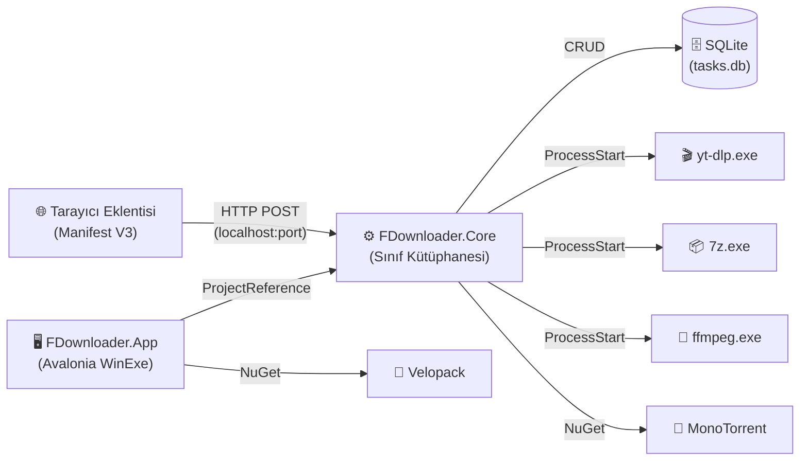

# FDownloader — Mimari Haritası

> **Oluşturuldu:** P0-01 görevi kapsamında, kaynak koddan doğrulanmıştır.

---

## 1. Proje Genel Bakış

| Alan | Değer |
|---|---|
| Çözüm dosyası | `FDownloader.sln` |
| .NET sürümü | net9.0 |
| UI çerçevesi | Avalonia 12.1.4 |
| Uygulama sürümü | 1.5.6 |
| Mimari deseni | MVVM (CommunityToolkit.Mvvm) |
| Veritabanı | SQLite (Microsoft.Data.Sqlite) |

---

## 2. Proje Yapısı

```
FDownloader/
├── src/
│   ├── FDownloader.Core/          ← İndirme motoru, iş mantığı
│   └── FDownloader.App/           ← Avalonia UI katmanı
├── tests/
│   └── FDownloader.Core.Tests/    ← Birim testleri (82 test, xUnit)
├── tools/
│   ├── 7z/                        ← Gömülü 7-Zip (7z.exe + 7z.dll)
│   ├── ffmpeg/                    ← ffmpeg + ffprobe ikili dosyaları
│   ├── yt-dlp/                    ← yt-dlp.exe (medya indirme)
│   └── browser-extension/         ← Chromium eklentisi (Manifest V3)
├── docs/                          ← Proje dokümantasyonu
├── .github/workflows/
│   └── release.yml                ← CI/CD: tag → derle → Velopack paketle → GitHub Release
└── FDownloader.sln
```

---

## 3. Bileşen Sorumlulukları

### 3.1 `FDownloader.Core` (Sınıf Kütüphanesi)

İndirme motoru ve tüm iş mantığı burada. `FDownloader.App`'a **ProjectReference** ile bağlanır. UI katmanına bağımlılığı yoktur.

| Alt Klasör / Dosya | Sorumluluk |
|---|---|
| `Config/AppSettings.cs` | Uygulama ayarlarının veri modeli (JSON serialization) |
| `Config/SchedulerSettings.cs` | Zamanlayıcı ayarları (başlatma/durdurma saatleri) |
| `Domain/DownloadTask.cs` | İndirme görevinin merkezi varlığı (URL, dosya adı, durum, parçalar) |
| `Domain/DownloadStatus.cs` | Görev durum enum'u (Queued, Downloading, Paused, Completed, Failed…) |
| `Domain/DownloadCategory.cs` | Kategori enum'u (Video, Audio, Document…) |
| `Domain/Segment.cs` | Bir HTTP parçasının modeli (başlangıç, bitiş, indirilen byte) |
| `Engine/HttpDownloader.cs` | Parçalı HTTP indirme motoru; SegmentPlanner, SegmentWorker ve FileWriter'ı orkestre eder |
| `Engine/Probe/DownloadProber.cs` | HEAD/Range isteğiyle sunucu özelliklerini ön yoklar (dosya boyutu, resume desteği, dosya adı) |
| `Engine/Segmenter/SegmentPlanner.cs` | Dosyayı kaç parçaya bölüneceğini hesaplar |
| `Engine/SpeedLimiter.cs` | Token-bucket tabanlı hız sınırlayıcı |
| `Engine/Worker/SegmentWorker.cs` | Tek bir HTTP parçasını indirir; hata ve yeniden deneme yönetimi |
| `Engine/Writer/FileWriter.cs` | Offset tabanlı disk yazıcı; birden fazla worker aynı dosyaya yazar |
| `Events/DownloadEventBus.cs` | Motor → UI arası olay köprüsü (event bus) |
| `Events/DownloadEvents.cs` | Olay tipleri (ProgressChanged, StatusChanged, SpeedUpdated…) |
| `Manager/DownloadManager.cs` | Görev kuyruğu, eşzamanlı indirme limiti, tüm görevlerin yaşam döngüsü |
| `Network/BrowserBridgeService.cs` | Tarayıcı eklentisinden gelen indirme isteklerini dinler (yerel HTTP sunucu) |
| `Network/NetworkConstants.cs` | Ağ sabitler (yerel port, timeout değerleri) |
| `Network/NetworkInterfaceHelper.cs` | Ağ adaptörü kilidi (VPN kill-switch) yardımcısı |
| `Network/ProbeResult.cs` | DownloadProber çıktısının veri modeli |
| `Storage/Database.cs` | SQLite bağlantısı, şema oluşturma ve migration |
| `Storage/DownloadRepository.cs` | Görev CRUD işlemleri (ekle, güncelle, sil, listele) |
| `Torrent/TorrentService.cs` | MonoTorrent ile BitTorrent/Magnet desteği |
| `Torrent/TorrentSettings.cs` | Torrent yapılandırması (port, DHT, hız limiti…) |
| `Utilities/ArchiveExtractorService.cs` | Gömülü 7-Zip ile arşiv çıkarma (RAR, 7z, ZIP, şifreli) |
| `Utilities/ClipboardWatcher.cs` | Pano değişikliklerini izler, URL algılarsa indirme önerir; Alt tuşu bypass |
| `Utilities/DiskSpaceChecker.cs` | Hedef diskte yeterli alan var mı kontrolü |
| `Utilities/FileNameSanitizer.cs` | Güvenli dosya adı temizleme (yasak karakter, ayrılmış ad, uzunluk) |
| `Utilities/HashCalculator.cs` | MD5/SHA1/SHA256 hesaplama |
| `Utilities/PathSafetyHelper.cs` | Hedef yolun izin verilen klasör içinde olduğunu doğrular |
| `Utilities/SiteGrabberService.cs` | Web sayfasından toplu link tarama |
| `Utilities/SpeedCalculator.cs` | Hareketli ortalama hız ve ETA hesabı |
| `Video/YtDlpMediaService.cs` | yt-dlp alt sürecini yönetir; video/ses indirme, format seçimi |

### 3.2 `FDownloader.App` (WinExe — Avalonia UI)

Yalnızca sunum katmanı. `FDownloader.Core`'a bağımlıdır; tersine bağımlılık yoktur.

| Dosya | Sorumluluk |
|---|---|
| `Program.cs` | Giriş noktası; Serilog, Sentry, Velopack başlatma |
| `App.axaml.cs` | Uygulama başlatma, DI konteyneri kurulumu |
| `ViewModels/MainViewModel.cs` | Ana ekranın tüm mantığı; görev listesi, ayarlar, hız ibresi, modal yönetimi |
| `ViewModels/DownloadItemViewModel.cs` | Tek bir indirme satırının görünüm modeli |
| `Views/MainWindow.axaml(.cs)` | Ana pencere XAML ve code-behind |
| `Views/ToastNotificationWindow.axaml(.cs)` | Toast bildirim penceresi |
| `Services/SoundPlayerService.cs` | Tamamlama sesi çalma |
| `Services/UpdateService.cs` | Velopack ile otomatik güncelleme |
| `Services/WindowsStartupService.cs` | Windows başlangıcına otomatik ekle/kaldır |

### 3.3 `FDownloader.Core.Tests` (xUnit Test Projesi)

82 birim testi. Şu an yalnızca Core katmanını test eder; App katmanı için UI testi yoktur.

### 3.4 `tools/browser-extension` (Manifest V3 Chromium Eklentisi)

| Dosya | Sorumluluk |
|---|---|
| `manifest.json` | Eklenti bildirimi (izinler, content script, background worker) |
| `background.js` | Service worker; indirme isteklerini yakalar, uygulamaya aktarır |
| `content.js` | Sayfa içi link tıklama yakalama; Alt tuşu bypass |
| `popup.html/js` | Eklenti popup arayüzü |

### 3.5 CI/CD (`.github/workflows/release.yml`)

- **Tetikleyici:** `v*` etiketi push
- **Adımlar:** checkout → .NET 9 kurulum → `dotnet restore` → `dotnet publish` (win-x64, self-contained) → yt-dlp/ffmpeg/eklenti kopyala → `vpk pack` (Velopack kurulum + güncelleme paketi) → GitHub Release oluştur
- **İmzalama:** Yoktur (P7-01'de planlanıyor)
- **Sürüm numarası kaynağı:** `FDownloader.App.csproj` → `<Version>` etiketi

---

## 4. Bileşen Bağımlılık Diyagramı



---

## 5. Veri Akışı — Temel İndirme

```
Kullanıcı URL girer
    → MainViewModel.AddDownloadCommand
    → DownloadManager.AddTaskAsync(url)
    → DownloadProber.ProbeAsync(url)        ← HEAD/Range isteği
    → SegmentPlanner.Plan(fileSize, parts)  ← Parça hesaplama
    → HttpDownloader.StartAsync()
        → N × SegmentWorker                 ← Paralel HTTP Range istekleri
        → FileWriter.WriteAsync(offset, buf)← Offset tabanlı disk yazımı
    → DownloadEventBus.Publish(events)      ← UI güncellemesi
    → DownloadRepository.UpdateProgress()  ← SQLite checkpoint
```

---

## 6. Görev Durumu Geçiş Tablosu

| Mevcut Durum | Geçiş | Yeni Durum |
|---|---|---|
| Queued | İndirme başlar | Downloading |
| Downloading | Kullanıcı durdurur | Paused |
| Downloading | Hata oluşur | Failed |
| Downloading | Tamamlanır | Completed |
| Paused | Kullanıcı devam ettirir | Downloading |
| Failed | Kullanıcı yeniden başlatır | Queued |

> ⚠️ Geçersiz geçiş koruması: P2-12 göreviyle birim testleriyle kapsanacak.

---

## 7. Önemli Mimari Notlar

- **Core ↔ UI ayrımı:** `FDownloader.Core` UI'ya bağımlı değildir. Bu, test edilebilirliğin temelidir. **P1-01 ATLANIR** (zaten ayrı).
- **Serilog:** `Program.cs`'de başlatılır, dosyaya yazar. Hassas veri maskeleme **uygulanmamıştır** (P1-05 gerekli).
- **Sentry:** Crash raporlama entegre. Kişisel veri filtresi kontrol edilmeli (P3-09).
- **Tek test projesi:** App katmanı için UI testi yoktur. Core testleri 82 adet.
- **Gömülü ikili dosyalar:** `tools/ffmpeg/` ve `tools/yt-dlp/` `.gitignore`'da hariç tutulmuş (boyut nedeniyle). CI'da runtime'da indiriliyor.
